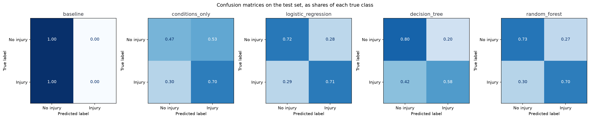
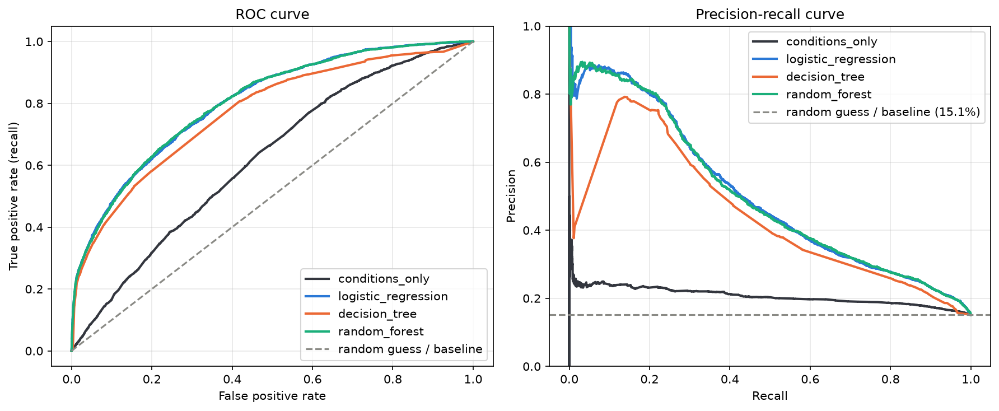

# DATA3800-gruppe-7

## Members

 - Erik Skålhegg (erska3276@oslomet.no)
 - Emirhan Güven (emguv8653@oslomet.no)
 - Abdulkadir Koc (abkoc1049@oslomet.no)
 - Haakon Meyer Tischbein (hatis6619@oslomet.no)
 - Sondre Gullichsen Ulsaker (souls3256@oslomet.no)

## About the project

#### What is this project?
* A data science project where the goal is to review an open dataset in light of scientific literature

#### What dataset was chosen?
[Traffic Crashes - Crashes](https://data.cityofchicago.org/Transportation/Traffic-Crashes-Crashes/85ca-t3if/data_preview) from the City of Chicago's Data Portal

#### What scientific literature was chosen?
* Analysis of driver injury severity levels at multiple locations using ordered probit models (https://doi.org/10.1016/j.jsr.2003.05.009)
* The statistical analysis of highway crash-injury severities: A review and assessment of methodological alternatives (https://doi.org/10.1016/j.aap.2011.03.025)

#### Main goals of this project:
* What factors make a traffic accident more or less likely to result in personal injury

## How to run the pipeline

Install uv first: https://docs.astral.sh/uv/getting-started/installation/. Then run these commands from the project root, in this order:

```bash
uv sync
uv run python data_fetch.py
uv run python run_cleaning.py
uv run python -m data3800_gruppe_7.modeling
uv run python -m data3800_gruppe_7.evaluation
uv run jupyter lab
```

1. `uv sync` installs the right Python version and the packages in `uv.lock`.
2. `data_fetch.py` downloads the raw data to `data/raw_dataset.csv`.
3. `run_cleaning.py` saves the cleaned data in `data/cleaned_crashes.csv`. The EDA notebook reads this file, so it has to exist before the notebook runs.
4. The modeling module fits the models on the crashes from January to August, chooses their settings on September and October, and saves the chosen models in `output/models/`, together with their predictions on November and December. The evaluation notebook reads these files.
5. The evaluation module computes the metrics, confusion matrices and feature importance, and saves the tables and figures in `output/evaluation/`. It takes about a minute.
6. In Jupyter, run the notebooks in order: `02-eda.ipynb`, `03-eg-modeling.ipynb` and `04_evaluation.ipynb`.

The `data/` and `output/models/` folders are not on GitHub, so a new clone needs steps 2 to 4 before the notebooks will run.

## Pipeline

| Step | Files | Output |
| --- | --- | --- |
| Download | `data_fetch.py` | `data/raw_dataset.csv` |
| Cleaning | `src/data3800_gruppe_7/cleaning.py`, `run_cleaning.py` | `data/cleaned_crashes.csv`, `output/cleaning_summary.txt` |
| Exploratory analysis | `notebooks/02-eda.ipynb` | Tables and figures in the notebook |
| Modeling | `src/data3800_gruppe_7/modeling.py`, `notebooks/03-eg-modeling.ipynb` | `output/models/*.joblib`, `output/models/predictions.csv`, `output/models/typical_crash.json` |
| Evaluation | `src/data3800_gruppe_7/evaluation.py`, `notebooks/04_evaluation.ipynb` | `output/evaluation/*.csv`, `output/evaluation/*.png` |
| GenAI assistant | `src/data3800_gruppe_7/assistant.py`, `src/data3800_gruppe_7/risk.py`, `run_assistant_examples.py` | A chat in the terminal that explains the results and scores a described crash, `output/assistant_examples.md` |

## Who did what

| Part | Responsible |
| --- | --- |
| Data cleaning | Abdulkadir Koc |
| Exploratory analysis | Erik Skålhegg |
| Modeling | Emirhan Güven |
| Evaluation | Haakon Meyer Tischbein |
| GenAI assistant | Emirhan Güven |
| Integration and documentation | Sondre Gullichsen Ulsaker, with the whole group |

## Results

### Exploratory analysis

After cleaning, the data has 108,903 police-reported crashes from 2025, and 16.4% of them involved at least one injury. The exploratory analysis found these patterns:

- The injury share is 15.9% in daylight and 20.7% in darkness on lighted roads.
- By hour, the share is lowest in the morning (13.8% at 10:00) and between 18.5 and 20.8% from 21:00 to 04:00.
- A higher posted speed limit goes with more injuries: 8.8% at 20 mph or less and 22.1% at 50 mph or more.
- Wet roads have an injury share of 20.5% and icy roads 10.3%.
- When the conditions are recorded as UNKNOWN, only 5.5 to 7.8% of the crashes involve injuries.

These are associations in police-reported crashes and do not show that the conditions cause the injuries. The four figures from the analysis are in `notebooks/02-eda.ipynb`.

### Models

The models are fitted on the crashes from January to August. We choose their settings on September and October, and the results below are from the 17,116 crashes in November and December, which the models never saw. The first version of the models only got the five conditions from the exploratory analysis. They now also get the layout of the road (traffic control device and type of trafficway) and how the crash happened (what was hit first, and how many vehicles and people were involved).

| Model | Accuracy | Precision | Recall | F1 | ROC-AUC | PR-AUC |
| --- | --- | --- | --- | --- | --- | --- |
| Baseline, always no injury | 0.849 | 0.000 | 0.000 | 0.000 | 0.500 | 0.151 |
| Logistic regression, five conditions only | 0.504 | 0.190 | 0.700 | 0.299 | 0.620 | 0.207 |
| Logistic regression | 0.719 | 0.312 | 0.713 | 0.434 | 0.803 | 0.502 |
| Decision tree | 0.768 | 0.343 | 0.580 | 0.431 | 0.770 | 0.434 |
| Random forest | 0.728 | 0.319 | 0.701 | 0.439 | 0.803 | 0.501 |

- The baseline has the best accuracy and finds no injuries, so we compare the models on recall, precision, F1 and PR-AUC instead.
- With only the five conditions, the model finds 70% of the injuries by flagging 56% of all crashes, and 19% of the flagged crashes had an injury. With all features it finds 71% by flagging 35%, and 31% of them had an injury, twice the share for a random crash.



- Logistic regression and the random forest are equally good: a paired bootstrap interval for their difference in PR-AUC contains 0. We prefer logistic regression because it is simpler and easier to interpret. The decision tree ranks crashes worse.



- How the crash happened is by far the most important input. A crash with a pedestrian has about 26 times the odds of injury of the other crash types, and a crash with a cyclist about 10 times. The road layout comes next, and the five conditions matter least.
- The conditions still point the same way as in the exploratory analysis: higher speed limits, wet roads, darkness and night-time go with more injuries.


- Crashes with UNKNOWN conditions have much lower odds of injury, which most likely reflects how minor crashes are reported rather than how crashes happen.
- The crash type is only known once a crash has happened. The models can therefore rank reported crashes by injury risk, but they cannot point out dangerous roads in advance.

## GenAI assistant

The assistant is a chat in the terminal that does two things.

It answers questions about our results. The language model gets the result files in `output/` (the cleaning summary and the evaluation tables) and is told to answer only from them, to name the file behind the numbers, and to say so when the files cannot answer.

It also scores a crash that you describe in your own words. The language model picks out the details, such as what was hit, the hour and the weather, and asks for our trained logistic regression to be run on them. The numbers come from our model and the test set, and the language model only explains them. For a described crash, `risk.py` returns:

- the risk score of the model, between 0 and 1
- how many crashes in the test set got about the same score, and how large a share of them had an injury, next to the 15.1% for all test crashes
- what the score would be if each given detail were swapped for its most common value, which shows what drives the score

The risk score is not a probability, because the model is trained with balanced class weights. The share of similar test crashes is the number to read as the chance of an injury. Details that are not given get their most common value, and the assistant says which ones it assumed. The tool rejects a value the model has never seen, because the encoder would otherwise ignore it without a warning.

The assistant needs a free API key from Google AI Studio, https://aistudio.google.com/apikey. Put the key in a file called `.env` in the project root. That file is in `.gitignore`, so the key stays on your own machine:

```text
GEMINI_API_KEY=your-key
```

Run the modeling and the evaluation first. Then start the chat, and stop it with an empty line:

```bash
uv run python -m data3800_gruppe_7.assistant
```

A single question also works:

```bash
uv run python -m data3800_gruppe_7.assistant "Which model is best?"
```

This is a real conversation from 18 November 2026. The line that starts with `score_crash:` shows what the language model sent to our model:

```text
> A car hit a pedestrian at 11 pm. It was raining, the road was wet and the street lights were
on.
score_crash: {"CRASH_HOUR": 23, "ROADWAY_SURFACE_COND": "WET", "LIGHTING_CONDITION": "DARKNESS,
LIGHTED ROAD", "FIRST_CRASH_TYPE": "PEDESTRIAN", "WEATHER_CONDITION": "RAIN"}
Among test crashes with a similar risk score, 80.5% involved an injury, compared with 15.1%
across all test crashes. The tool assumed typical values for the speed limit (30 mph), number of
units (2), trafficway type (not divided), and traffic control device (no controls). Whether the
vehicle hits a pedestrian rather than a parked motor vehicle matters most for this score. The
crash hour, lighting condition, and wet road surface also raise the associated risk slightly.
These findings represent associations in police-reported crashes rather than direct causes.

> And if the car had hit a parked car instead?
score_crash: {"CRASH_HOUR": 23, "FIRST_CRASH_TYPE": "PARKED MOTOR VEHICLE", "WEATHER_CONDITION":
"RAIN", "ROADWAY_SURFACE_COND": "WET", "LIGHTING_CONDITION": "DARKNESS, LIGHTED ROAD"}
Among test crashes with a similar risk score, 6.1% involved an injury, compared with 15.1%
across all test crashes. The tool assumed typical values for the speed limit (30 mph), number of
units (2), trafficway type (not divided), and traffic control device (no controls). The hour of
the crash matters most in raising the score for this scenario. The lighting condition and wet
road surface also slightly increase the associated risk. These findings represent associations
in police-reported crashes rather than direct causes.

> Which model is best, and how sure are we?
The group prefers the logistic regression because it scores similarly to the random forest and
is easier to interpret. On the test set, logistic regression achieved a PR-AUC of 0.502 and an
F1-score of 0.434 [output/evaluation/metrics.csv]. The random forest achieved a PR-AUC of 0.501
and an F1-score of 0.439 [output/evaluation/metrics.csv]. The 95% bootstrap interval for the
difference between logistic regression and random forest includes 0 for both F1 (-0.012 to
0.002) and PR-AUC (-0.008 to 0.011), meaning their performance does not differ significantly
[output/evaluation/metric_intervals.csv]. Logistic regression is significantly better than the
decision tree, as their PR-AUC difference interval excludes 0 (0.056 to 0.080)
[output/evaluation/metric_intervals.csv].
```

The assistant uses Google's Gemini API through the `google-genai` library, as in the course example. The default model is `gemini-3.5-flash-lite`. In November 2026 its free tier allowed 15 requests a minute and 500 a day. We let it think at the highest level before it answers, because with less thinking it guessed details the user had not given. `gemini-3.8-flash` is a stronger model, but its free tier only allowed 5 requests a minute and 20 a day, and on the evening we tested it, it was too busy to answer. To use it or another model, add `GEMINI_MODEL=<model id>` to `.env`.

`run_assistant_examples.py` asks the assistant eight fixed questions and saves the answers in `output/assistant_examples.md`, with the tool calls behind them. The questions cover the results, three described crashes (one in Norwegian and one with a speed limit of 500 mph), a question about cause, a question the data cannot answer and a request outside the project. A language model does not answer the same way every time, so we read the answers and compare their numbers with the files.

---

## Internal

### Prerequisites
Install uv: https://docs.astral.sh/uv/getting-started/installation/

### One-time setup
```bash
git clone <repo-url>
cd DATA3800-gruppe-7
uv sync                    # builds .venv from the lockfile, installs the correct Python if missing
uv run pre-commit install  # activates notebook output stripping on commit
```

### Every session
```bash
git pull
uv sync             # picks up dependencies others have added
uv run jupyter lab  # or select the .venv kernel in VS Code
```

### Adding a dependency
```bash
uv add <package>
```
Commit `pyproject.toml` and `uv.lock` together in the same commit.
If `uv.lock` gets a merge conflict, don't edit it by hand: accept either side, run `uv lock`, and commit the result.

### Notebooks
* Name notebooks `NN-initials-topic.ipynb`, e.g. `01-hmt-eda.ipynb`. One notebook, one owner.
* Reusable code (loading, cleaning, features) goes in `src/`, not in notebooks.
* Start every notebook with `%load_ext autoreload` and `%autoreload 2` so edits in `src/` are picked up without restarting the kernel.
* Outputs are stripped automatically on commit, except in the notebooks that set `keep_output` in their metadata. The three analysis notebooks (`02`, `03` and `04`) do, so their results show on GitHub. If a commit is aborted because the hook modified files, `git add` the notebook and commit again.
