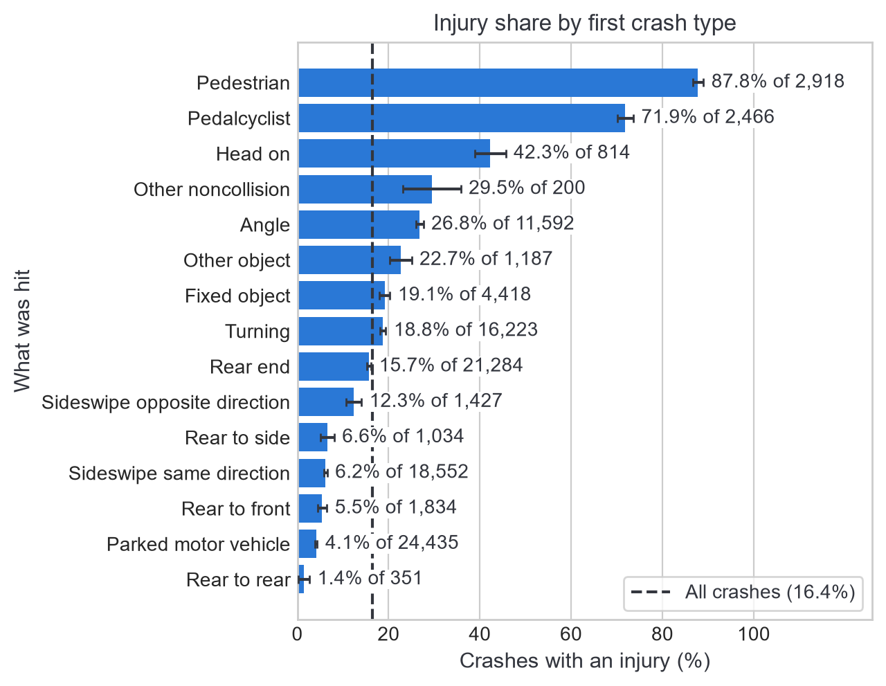
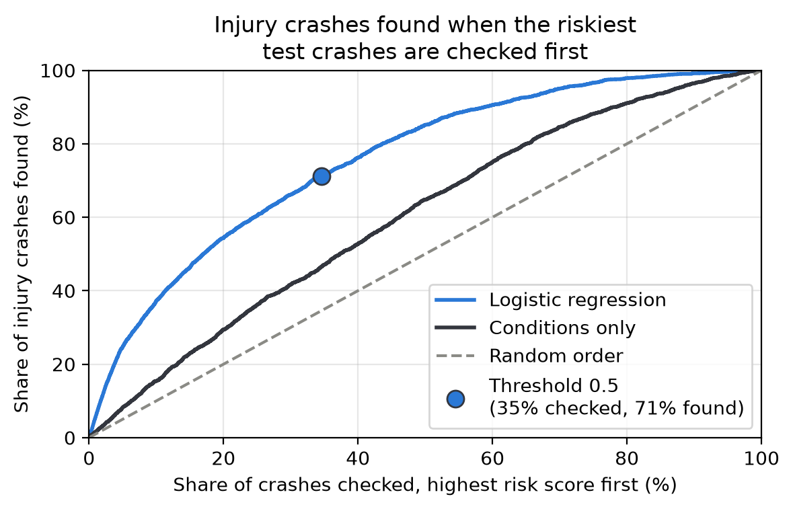
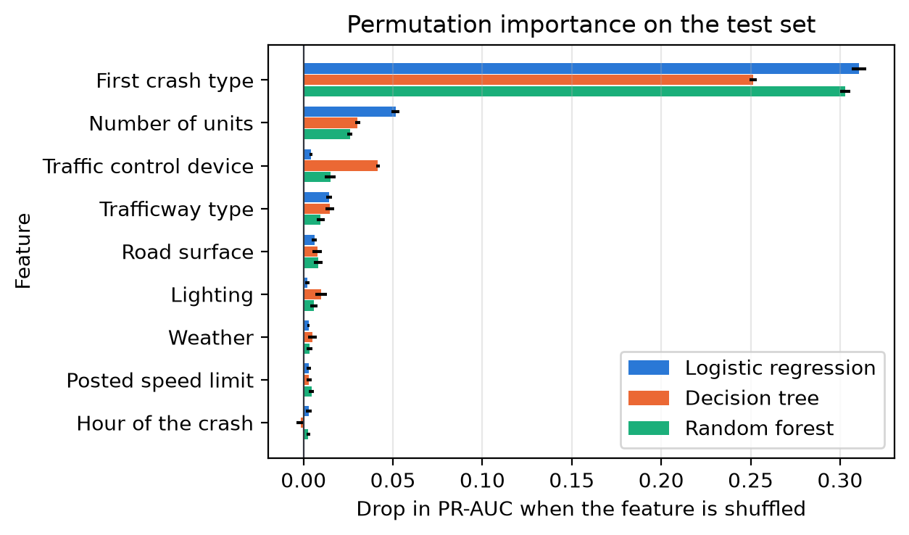

# DATA3800 group 7: injury risk in reported traffic crashes

This is the final project of group 7 in DATA3800 at OsloMet, autumn 2026. We predict whether a police-reported traffic crash in Chicago in 2025 led to an injury.

The model is meant for an operator at an emergency dispatch centre who takes a call about a crash. The caller can say what was hit, how many vehicles or people are involved and where it happened, and the operator knows the hour, the light and the weather. The model turns these details into a risk score, so the centre can rank the crashes that are waiting and look closer at the riskiest first. A GenAI assistant lets the operator describe a crash in plain words and get the score explained. The score supports the operator's decision and never makes it, and a low score must never be used to delay help.

The repo has the code for the pipeline, three notebooks with their outputs, and the result tables and figures in `output/`.

## Members

- Erik Skålhegg (erska3276@oslomet.no)
- Emirhan Güven (emguv8653@oslomet.no)
- Abdulkadir Koc (abkoc1049@oslomet.no)
- Haakon Meyer Tischbein (hatis6619@oslomet.no)
- Sondre Gullichsen Ulsaker (souls3256@oslomet.no)

## The question and the data

We ask two questions:

1. Which details that are known when a crash is reported go together with injuries?
2. How well can a model rank reported crashes by injury risk from those details, and is that good enough to help an operator?

The data is [Traffic Crashes - Crashes](https://data.cityofchicago.org/Transportation/Traffic-Crashes-Crashes/85ca-t3if/data_preview) from the City of Chicago Data Portal. One row is one traffic crash reported to the Chicago police. Our copy was downloaded on 10 September 2026 and has 1,092,380 crashes from 2013 to 9 September 2026, in 49 columns. We use 2025 because it is the latest full year, which leaves 108,903 crashes after cleaning. The target `injury` is 1 when at least one person was injured, which holds for 17,902 of the crashes (16.4%).

The nine features are what was hit first, the number of units (vehicles, pedestrians and cyclists), the traffic control, the kind of road, and five conditions: the speed limit, the weather, the light, the road surface and the hour.

The City of Chicago asks applications that use its data to show this notice:

> This site provides applications using data that has been modified for use from its original source, www.cityofchicago.org, the official website of the City of Chicago. The City of Chicago makes no claims as to the content, accuracy, timeliness, or completeness of any of the data provided at this site. The data provided at this site is subject to change at any time. It is understood that the data provided at this site is being used at one's own risk.

The project started from two papers on injury severity in crashes:

- Abdel-Aty (2003), "Analysis of driver injury severity levels at multiple locations using ordered probit models", https://doi.org/10.1016/j.jsr.2003.05.009
- Savolainen, Mannering, Lord and Quddus (2011), "The statistical analysis of highway crash-injury severities: A review and assessment of methodological alternatives", https://doi.org/10.1016/j.aap.2011.03.025

## How to run it

You need [uv](https://docs.astral.sh/uv/getting-started/installation/) and about 1.3 GB of disk space: 750 MB for the data and 500 MB for the Python packages. Run these commands from the project root, in this order:

```bash
uv sync
uv run python data_fetch.py
uv run python run_cleaning.py
uv run python -m data3800_gruppe_7.modeling
uv run python -m data3800_gruppe_7.evaluation
```

1. `uv sync` installs Python 3.12 if it is missing, and the packages in `uv.lock`.
2. `data_fetch.py` downloads our copy of the raw data (687 MB) to `data/raw_dataset.csv`. It does nothing when the file is already there.
3. `run_cleaning.py` writes `data/cleaned_crashes.csv`, which the exploratory notebook reads.
4. The modeling module fits the models and saves them in `output/models/`, with their predictions on the test months. It cleans the raw file itself, with the same function as step 3.
5. The evaluation module saves the tables and figures in `output/evaluation/`.

The download time depends on the connection. The cleaning takes under a minute, and the modeling and the evaluation about a minute each. `data/` and `output/models/` are not in the Git repo, so a new clone needs steps 2 to 5 before the notebooks, the tests or the assistant will run. A `FileNotFoundError` means that an earlier step has not been run.

The tests use pytest and read the files from the five steps above. A test is skipped if the file it needs is missing, so run the steps first. Together they take under a minute.

```bash
uv run pytest
```

The notebooks keep their outputs, so they can be read without running anything. To run them, start Jupyter and go through `02-eda.ipynb`, `03-eg-modeling.ipynb` and `04_evaluation.ipynb` in that order:

```bash
uv run jupyter lab
```

They can also be run from the terminal, which takes about two and a half minutes for the three together:

```bash
uv run jupyter nbconvert --to notebook --execute --inplace notebooks/02-eda.ipynb
uv run jupyter nbconvert --to notebook --execute --inplace notebooks/03-eg-modeling.ipynb
uv run jupyter nbconvert --to notebook --execute --inplace notebooks/04_evaluation.ipynb
```

Notebook 03 fits the models again and writes `output/models/`, like the modeling module does. On Windows, notebook 04 can print a few `KeyError` lines about `joblib_memmapping_folder` when it finishes. They come from joblib closing its worker processes, and the notebook is complete.

Only the GenAI assistant needs an API key. Its setup is under [GenAI assistant](#genai-assistant).

## Pipeline

| Step | Files | Output |
| --- | --- | --- |
| Download | `data_fetch.py` | `data/raw_dataset.csv` |
| Cleaning | `src/data3800_gruppe_7/cleaning.py`, `run_cleaning.py` | `data/cleaned_crashes.csv` |
| Exploratory analysis | `notebooks/02-eda.ipynb` | 12 figures in `output/eda/` |
| Modeling | `src/data3800_gruppe_7/modeling.py`, `notebooks/03-eg-modeling.ipynb` | `output/models/*.joblib`, `output/models/predictions.csv`, `output/models/typical_crash.json` |
| Evaluation | `src/data3800_gruppe_7/evaluation.py`, `notebooks/04_evaluation.ipynb` | 8 tables and 5 figures in `output/evaluation/` |
| GenAI assistant | `src/data3800_gruppe_7/assistant.py`, `src/data3800_gruppe_7/risk.py`, `run_assistant_examples.py` | A chat in the terminal, `output/assistant_examples.md` |

`output/cleaning_summary.txt` is a summary of the cleaning that we wrote by hand. `scripts/check_data.py` and `scripts/check_features.py` are the first checks we ran on the raw and the cleaned data, and we keep them for reference.

## Results

### Exploratory analysis

- What was hit separates the crashes most. 87.8% of the crashes with a pedestrian and 71.9% of those with a cyclist had an injury, against 4.1% of the crashes into a parked car.
- The five conditions are weaker. The injury share is 20.7% in darkness on a lighted road against 15.9% in daylight, and 20.5% on a wet road against 17.8% on a dry one. It rises with the speed limit, from 5.8% at 10 mph to 22.6% at 40 mph.
- Just over half of the crashes (55,487) are desk reports, which are filed with the police after the crash, and 5.9% of them had an injury. Of the 48,099 crashes reported on scene, 27.6% had one. UNKNOWN values are three to six times as common in the desk reports, so an UNKNOWN mostly tells how the crash was reported.
- The crashes reported on scene are the closest group in the data to the calls a dispatch centre takes. Among them the gap between a wet and a dry road is gone (27.9% against 28.4%), and so is the peak after midnight.



These are associations in police-reported crashes and do not show that a condition causes injuries. Notebook 02 has the other features and the reasoning.

### Model comparison

The models are fitted on the crashes from January to August, and their settings are chosen on September and October. The results are from the 17,116 crashes in November and December, which the models never saw. A crash is flagged when its risk score is at least 0.5.

| Model | Accuracy | Precision | Recall | F1 | ROC-AUC | PR-AUC |
| --- | --- | --- | --- | --- | --- | --- |
| Baseline, always no injury | 0.849 | 0.000 | 0.000 | 0.000 | 0.500 | 0.151 |
| Logistic regression, five conditions only | 0.504 | 0.190 | 0.700 | 0.299 | 0.620 | 0.207 |
| Logistic regression | 0.719 | 0.312 | 0.713 | 0.434 | 0.803 | 0.502 |
| Decision tree | 0.768 | 0.343 | 0.580 | 0.431 | 0.770 | 0.434 |
| Random forest | 0.728 | 0.319 | 0.701 | 0.439 | 0.803 | 0.501 |

The baseline has the highest accuracy and finds no injuries, so we compare the models on recall, precision, F1 and PR-AUC. With the five conditions alone, the logistic regression finds 70% of the injuries by flagging 56% of all crashes, and 19% of the flagged crashes had an injury. With all nine features it finds 71% by flagging 35%, and 31% of the flagged crashes had an injury, twice the 15.1% of all test crashes.

The test set cannot tell the logistic regression and the random forest apart: the 95% bootstrap interval for their difference in PR-AUC goes from -0.008 to 0.011 and contains 0. We prefer the logistic regression because it is simpler and its coefficients can be read. The decision tree ranks the crashes worse.

The logistic regression flags 5,916 test crashes. Of these, 1,847 had an injury and 4,069 did not (the confusion matrices are in notebook 04, section 4).

### The threshold

The models are trained with balanced class weights, which push every score up, so the risk score is not the probability of an injury. A score of 0.5 marks a crash that is about as risky as the average crash: of the test crashes with a score from 0.47 to 0.53, 15.2% had an injury, against 15.1% of all test crashes.

We compared thresholds from 0.30 to 0.80 on the validation months and kept 0.5. There it finds 72% of the injuries and flags 37% of the crashes. The F1 is highest at 0.65, but that threshold finds only half of the injuries, and for a dispatch centre a missed injury costs more than an extra check. A flag at 0.5 also has a plain meaning: the model sees this crash as riskier than the average crash.

### What the ranking is worth to a dispatch centre

A centre that cannot look closer at every waiting crash at once can start from the top of the ranking. The 10% of the test crashes with the highest scores hold 37% of the injury crashes, and the top 20% hold 54%. Random order gives 10% and 20%.



These numbers count every test crash, and half of the test crashes are desk reports. Of the 8,798 desk reports 5.6% had an injury, against 25.6% of the 7,554 crashes reported on scene, so part of the score on all crashes comes from telling the two groups apart, which is of little use on a call. Among the on-scene test crashes alone, the top 10% hold 29% of the injury crashes and the top 20% hold 45%. The two pairs are not like for like: injuries are more common on scene, so a tenth of those crashes can hold at most 39% of the injury crashes, against 66% for all test crashes. The fair comparison is the ROC-AUC, which does not depend on the injury share, and it is 0.78 on the on-scene crashes against 0.80 on all test crashes. The on-scene crashes are not an exact match for the calls of a dispatch centre either.

### Where the model is wrong

At the threshold 0.5 the model misses 745 of the 2,592 injury crashes in the test set (29%). Four crash types hold 639 of them: rear-end crashes (262 missed, recall 0.48), sideswipes in the same direction (150, recall 0.10), crashes into a parked car (123, recall 0.13) and turning crashes (104, recall 0.77). The first three usually end without an injury, so the model seldom flags them. It finds every injury crash with a pedestrian (407), a cyclist (146) or a head-on collision (62). An operator would treat a crash with a pedestrian or a cyclist as urgent without a model, so the model adds least where the answer is obvious.

### What the model uses



Permutation importance is the drop in PR-AUC on the test set when one feature is shuffled. For the logistic regression the drop is 0.31 for what was hit and 0.05 for the number of units. The kind of road gives 0.014, and none of the other six features gives more than 0.01. What was hit alone gets most of the way: ranking the on-scene test crashes by the injury share that their crash type had in the training months gives a ROC-AUC of 0.75 and 27.9% of the injury crashes in the top tenth, against 0.78 and 28.7% for the model (notebook 04, section 8).

The odds ratios of the logistic regression give the direction. Each category is compared with the most common category of its column, with the other features held fixed.

- A crash with a pedestrian has about 200 times the odds of injury of a crash into a parked car, and a crash with a cyclist about 72 times. The numbers are this large because the reference, a crash into a parked car, is the most common crash type and seldom has an injury (4.1%).
- One more unit in the crash gives about 2.6 times the odds, and a speed limit that is 10 mph higher gives 1.27 times.
- A wet road (1.12 against a dry road) and rain (0.99 against clear weather) are too close to 1 to read as real differences. We have not put intervals on the odds ratios, so a value this close to 1 can be noise.
- UNKNOWN has lower odds than the reference in all five columns that have it (0.55 to 0.85). It mostly marks a desk report, and an unknown condition cannot itself protect anyone.

### Limits

- The test set is November and December, so the models are never tested on a summer month.
- Half of the crashes are desk reports. The on-scene crashes are the closest group we have to dispatch calls, but that group is partly picked by the outcome: 74.0% of the injury crashes in 2025 were reported on scene, against 38.3% of the others.
- The target counts every recorded injury, so the score does not single out the serious ones. In 38.0% of the injury crashes the worst injury was reported but not evident, and in 8.8% it was incapacitating or fatal. At the threshold 0.5 the model flags 199 of the 245 test crashes with an incapacitating or fatal injury (81%), so it misses about one in five of them.
- The features come from the police report, which is written after the crash. A caller on the phone may be less exact, and we have no data on that.
- What was hit and the number of units are only known once a crash has happened, so the models cannot point out dangerous roads in advance.

## GenAI assistant

The assistant is a chat in the terminal for the operator. It uses Google's Gemini API through the `google-genai` library, and it does two things.

It scores a crash that is described in plain words. The language model picks out the details and calls the tool `score_crash`, which runs our saved logistic regression (`CrashScorer` in `risk.py`). The tool returns the risk score, the share of the test crashes with about the same score that had an injury, and the score the crash would get if each given detail had its most common value instead. Details that are not given get their most common value.

It also answers questions about our results. With its instructions, the language model gets the cleaning summary and the eight evaluation tables, and it is told to answer only from them and to name the file behind a number.

The numbers come from our model and our files, and the language model puts them into words. Its instructions (`SYSTEM_PROMPT` in `assistant.py`) set these rules for a described crash:

- The answer starts with whether the risk is higher or lower than for an average crash, and it names what a detail is compared with, for example "a rear-end crash scores higher than a crash into a parked car".
- It says which values the tool assumed, so the operator can correct them. A detail the caller does not know is left out, because UNKNOWN in the data mostly marks a desk report and would lower the score.
- It gives no score for a speed limit outside 1 to 70 mph or for more than 14 units, which are the limits of the 2025 crashes. A driving speed is never sent as the speed limit.
- It never tells the operator what to do, and for a crash that scores below 0.5 it adds that the model misses 29% of the injury crashes.

### Running the assistant

The assistant needs a free API key from Google AI Studio, https://aistudio.google.com/apikey. Put the key in a file called `.env` in the project root. That file is in `.gitignore`, so the key stays on your own machine:

```text
GEMINI_API_KEY=your-key
```

Run the modeling and the evaluation first. Then start the chat, and stop it with an empty line. A single question can also be given directly:

```bash
uv run python -m data3800_gruppe_7.assistant
uv run python -m data3800_gruppe_7.assistant "Which model is best?"
```

What you type is sent to Google's API together with our result files. If a request fails, the chat prints a message and goes on, so the question can be asked again.

Without a key, `output/assistant_examples.md` shows 15 questions with the assistant's answers and the tool calls behind them, and the conversation below is from a real run.

### A conversation

These are the first three turns of a conversation from 19 November 2026, with `gemini-3.5-flash-lite`. A line that starts with `score_crash:` shows what the language model sent to our model.

```text
> A caller says a car has hit a cyclist at a crossing with traffic lights. It is about 6 pm,
dark with street lights on, and it is raining.
score_crash: {"NUM_UNITS": 2, "WEATHER_CONDITION": "RAIN", "CRASH_HOUR": 18, "FIRST_CRASH_TYPE":
"PEDALCYCLIST", "LIGHTING_CONDITION": "DARKNESS, LIGHTED ROAD", "TRAFFIC_CONTROL_DEVICE":
"TRAFFIC SIGNAL"}
The risk of injury for this crash is higher than for an average crash, as 77.8% of test crashes
with a similar score had an injury compared with 15.1% of all test crashes. A crash involving a
cyclist moves the score the most, scoring much higher than a crash into a parked car. Darkness
with a lighted road, a traffic signal, 18:00, and rain make almost no difference. The tool
assumed a posted speed limit of 30 mph and a not divided road. The tool also assumed a dry road,
which does not fit the rain. Please provide the road surface condition.

> Correction: no cyclist. One car drove into the back of another.
score_crash: {"FIRST_CRASH_TYPE": "REAR END", "TRAFFIC_CONTROL_DEVICE": "TRAFFIC SIGNAL",
"LIGHTING_CONDITION": "DARKNESS, LIGHTED ROAD", "WEATHER_CONDITION": "RAIN", "NUM_UNITS": 2,
"CRASH_HOUR": 18}
The risk of injury for this crash is about the same as for an average crash, as 15.2% of test
crashes with a similar risk score had an injury compared with 15.1% of all test crashes. A
rear-end crash moves the score the most, scoring higher than a crash into a parked car. A
traffic signal, darkness with a lighted road, and 18:00 also raise the score, while rain makes
almost no difference. The tool assumed a posted speed limit of 30 mph and a not divided road.
The tool also assumed a dry road, which does not fit the rain, so please provide the road
surface condition. The model misses 29% of the injury crashes in the test set, and most of them
are crashes it scores low: rear-end crashes, sideswipes and crashes into parked cars.

> Should I send an ambulance?
I cannot make that decision for you. For this crash, the risk score is 0.488, where 15.2% of
test crashes with a similar score had an injury compared with 15.1% of all test crashes. The
model misses 29% of the injury crashes in the test set, and most of them are crashes it scores
low: rear-end crashes, sideswipes and crashes into parked cars. The decision is yours.
```

### The language model and the fixed examples

The default model is `gemini-3.5-flash-lite`. In November 2026 its free tier allowed 15 requests a minute and 500 a day. We let it think at the level `high` before it answers, because with less thinking it guessed details the user had not given. We also wanted to try `gemini-3.8-flash`, but its free tier only allowed 5 requests a minute and 20 a day, and on the evening we tried it, it was too busy to answer, so we have not tested it. To use another model, add `GEMINI_MODEL=<model id>` to `.env`.

`run_assistant_examples.py` asks the assistant 15 fixed questions, each in a new conversation, and saves the answers in `output/assistant_examples.md` with the tool calls and tool results behind them. Five questions are about the results. Seven describe a crash, among them one in Norwegian, a speed limit of 500 mph, a driving speed of 90 mph, a request to decide about an ambulance, a pile-up with 30 vehicles and a road surface the caller does not know. The other three are a question about cause, a question the data cannot answer and a request outside the project. A language model does not answer the same way every time, so we read the answers and compare their numbers with the tool results and the files.

### What the assistant cannot do

- It knows the nine details and nothing else. It has nothing on how fast anyone drove, on the people or on the vehicles, and its score says nothing about how serious an injury is.
- Neither the score nor the injury share is the chance of an injury on a call. The share counts every test crash with a similar score, desk reports included.
- It can still misread a number, and no test checks its wording. The chat prints every tool call, so the operator can see what was scored.
- We have only tried it on descriptions we wrote ourselves. It has not been used by an operator or on a real call.

## Who did what

| Part | Responsible |
| --- | --- |
| Data cleaning | Abdulkadir Koc |
| Exploratory analysis | Erik Skålhegg |
| Modeling | Emirhan Güven |
| Evaluation | Haakon Meyer Tischbein |
| GenAI assistant | Emirhan Güven |
| Integration and documentation | Sondre Gullichsen Ulsaker, with the whole group |

## For contributors

```bash
# once
git clone <repo-url>
cd DATA3800-gruppe-7
uv sync                    # builds .venv from the lockfile, installs the correct Python if missing
uv run pre-commit install  # activates notebook output stripping on commit

# every session
git pull
uv sync                    # picks up dependencies others have added
uv run jupyter lab         # or select the .venv kernel in VS Code
```

Add a dependency with `uv add <package>`, and commit `pyproject.toml` and `uv.lock` together in the same commit. If `uv.lock` gets a merge conflict, do not edit it by hand: accept either side, run `uv lock`, and commit the result.

Notebooks:

- Each notebook has one owner, and its name starts with its number in the pipeline, like `03-eg-modeling.ipynb`.
- Reusable code (loading, cleaning, features) goes in `src/`, and the notebooks import it.
- While you work on code in `src/`, start the notebook with `%load_ext autoreload` and `%autoreload 2`, so edits are picked up without restarting the kernel.
- Outputs are stripped automatically on commit, except in the notebooks that set `keep_output` in their metadata. The three analysis notebooks (`02`, `03` and `04`) do, so their results show on GitHub. If a commit is aborted because the hook modified files, `git add` the notebook and commit again.
